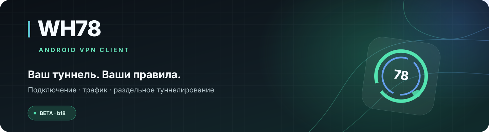
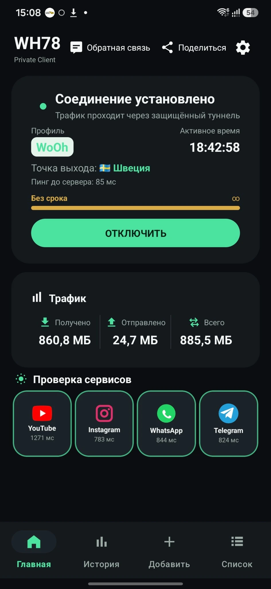
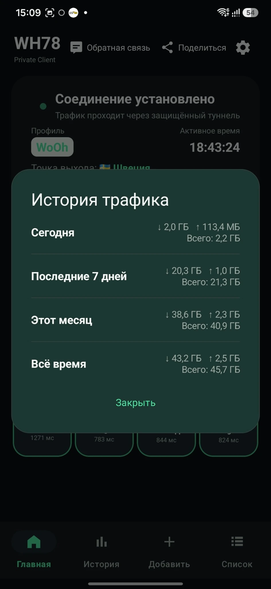
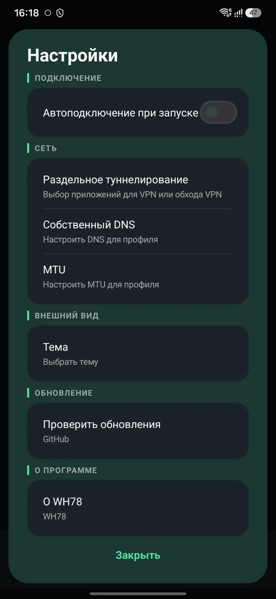

<div align="center">
  
  <br>
  <p>
    <a href="https://github.com/WoOh78/WH78/releases/latest"></a>
    <a href="https://github.com/WoOh78/WH78/releases/tag/b18"></a>
    <a href="https://github.com/amnezia-vpn/amneziawg-android"></a>
  </p>
  <p><strong>Android-клиент для VPN-подключений на базе AmneziaWG</strong></p>
  <p>Подключение, контроль трафика и настройка приложений — в одном понятном интерфейсе.</p>
</div>

> **Статус:** Beta. WH78 — самостоятельная модификация Android-клиента AmneziaWG, а не официальный продукт команды Amnezia. Текущий публичный релиз, указанный в этом README: **b18**.

## Быстрые ссылки

- **[Скачать WH78](https://github.com/WoOh78/WH78/releases/latest)** — APK и описание релиза
- [Релиз b18](https://github.com/WoOh78/WH78/releases/tag/b18)
- [Сообщить об ошибке или предложить улучшение](https://github.com/WoOh78/WH78/issues)
- [Исходный проект AmneziaWG Android](https://github.com/amnezia-vpn/amneziawg-android)
- [Что такое AmneziaWG](https://docs.amnezia.org/ru/documentation/amnezia-wg/)

## Что такое WH78?

**WH78 — это приложение для Android, которое подключает телефон к VPN по конфигурации AmneziaWG.** Оно помогает управлять туннелями и смотреть, как используется соединение, без необходимости каждый раз открывать технические настройки.

Важно: **WH78 само по себе не предоставляет VPN-сервер, подписку или готовый доступ в интернет.** Для подключения нужен конфигурационный файл `.conf` или QR-код, полученный от своего VPN-сервера или провайдера, совместимого с AmneziaWG.

## Возможности

<table>
  <tr>
    <td width="50%" valign="top">
      <h3>🔐 Подключение VPN</h3>
      Импорт профиля из файла <code>.conf</code> или QR-кода, управление несколькими туннелями и быстрое подключение/отключение.
    </td>
    <td width="50%" valign="top">
      <h3>🧩 Раздельное туннелирование</h3>
      Выбери приложения, чей трафик должен идти через VPN, или приложения, которые нужно исключить из туннеля.
    </td>
  </tr>
  <tr>
    <td width="50%" valign="top">
      <h3>📊 Трафик и история</h3>
      На главном экране видны полученные, отправленные и общие данные. История показывает сводки за сегодня, 7 дней, месяц и всё время.
    </td>
    <td width="50%" valign="top">
      <h3>🌍 Информация о соединении</h3>
      Отображение точки выхода и задержки до сервера, если их удаётся определить для текущего соединения.
    </td>
  </tr>
  <tr>
    <td width="50%" valign="top">
      <h3>🎨 Четыре темы</h3>
      Premium Dark, Light, Blue и Cyberpunk. Выбирай стиль, который удобнее именно тебе.
    </td>
    <td width="50%" valign="top">
      <h3>⏳ Срок действия профиля</h3>
      Если для профиля задан срок действия, приложение может показывать оставшееся время и дату окончания.
    </td>
  </tr>
  <tr>
    <td width="50%" valign="top">
      <h3>⚡ Быстрые настройки Android</h3>
      Поддерживается системная плитка для быстрого переключения туннеля из панели быстрых настроек.
    </td>
    <td width="50%" valign="top">
      <h3>🔄 Обновления через GitHub</h3>
      В приложении есть проверка опубликованных релизов GitHub и установка загруженного APK с подтверждением Android.
    </td>
  </tr>
</table>

На главном экране также есть проверки доступности/задержки ряда сервисов. Результат зависит от сети, сервера и доступности конкретного адреса; он не гарантирует, что каждый сервис будет работать во всех условиях.

## Посмотрите интерфейс

<p align="center">
  
  &nbsp;
  
  &nbsp;
  
</p>

<p align="center"><sub>Главный экран · История трафика · Выбор приложений. Скриншоты сделаны на реальном устройстве. Они иллюстрируют основные функции; отдельные элементы и их расположение могут отличаться в разных сборках.</sub></p>

<details>
  <summary><strong>Посмотреть настройки</strong></summary>
  <p align="center"></p>
  <p align="center"><sub>Настройки подключения, раздельного туннелирования, темы и проверки обновлений.</sub></p>
</details>

## Как установить — пошагово

Никаких команд и Android Studio для обычной установки не нужно.

1. Открой страницу **[последнего релиза WH78](https://github.com/WoOh78/WH78/releases/latest)**.
2. В разделе **Assets** скачай APK-файл релиза. Для b18 это `WH78-b18.apk`.
3. Открой скачанный файл на телефоне. Если Android попросит разрешение, разреши установку неизвестных приложений для браузера или файлового менеджера, из которого запускаешь APK.
4. Подтверди установку и открой WH78. Если включал разрешение на установку из неизвестного источника только ради этого шага, после установки можешь его отключить.
5. Открой пункт **«Добавить»** и импортируй `.conf` или QR-код от своего VPN-сервера/провайдера.
6. Выбери добавленный профиль и нажми подключение. При первом запуске Android покажет системный запрос на разрешение VPN — это штатное поведение.

**Безопасность:** скачивай APK только со страницы релизов [этого репозитория](https://github.com/WoOh78/WH78/releases). Не устанавливай файлы, присланные неизвестными людьми или размещённые на сторонних сайтах.

### Обновление приложения

- В WH78 открой настройки и выбери **«Проверить обновления»**, либо скачай APK со страницы [Releases](https://github.com/WoOh78/WH78/releases/latest).
- Если приложение обнаружило новую версию, следуй подсказкам Android и подтверди установку.
- Обновление поверх установленной копии возможно, когда APK подписан тем же ключом, что и предыдущая версия. Если Android сообщает о конфликте подписи, не удаляй приложение сразу: сначала сохрани конфигурации туннелей и проверь, откуда была установлена текущая версия.

## Как это работает — без сложных терминов

1. **Профиль** содержит параметры подключения к VPN-серверу.
2. **AmneziaWG** создаёт защищённый VPN-туннель между телефоном и сервером. Протокол основан на WireGuard и добавляет механизмы обфускации сетевого трафика; эффективность зависит от сети и настройки сервера. Подробнее — в [документации AmneziaWG](https://docs.amnezia.org/ru/documentation/amnezia-wg/).
3. **Android направляет выбранный трафик в туннель.** Правила раздельного туннелирования определяют, какие приложения используют VPN, а какие идут напрямую.
4. **WH78 показывает состояние подключения и статистику**, чтобы было проще понять, работает ли профиль и сколько данных прошло через соединение.

WH78 — это клиентская часть. Адрес сервера, его доступность, ограничения и правила использования определяются твоим VPN-сервером или провайдером.

## Частые вопросы

<details>
  <summary><strong>WH78 — это VPN-сервис с бесплатными серверами?</strong></summary>
  Нет. WH78 — приложение-клиент. Для подключения нужен собственный сервер или конфигурация от VPN-провайдера, поддерживающего AmneziaWG.
</details>

<details>
  <summary><strong>Что выбрать: «Включить для» или «Исключить для»?</strong></summary>
  «Включить для» — в туннель направляются выбранные приложения. «Исключить для» — выбранные приложения обходят VPN, а остальные используют его согласно конфигурации. Проверь выбранный режим перед подключением.
</details>

<details>
  <summary><strong>Почему не определяется страна или пинг?</strong></summary>
  Это дополнительная информация, которая зависит от сети, VPN-сервера и доступности внешних узлов проверки. Отсутствие страны или пинга не всегда означает, что сам туннель не работает.
</details>

<details>
  <summary><strong>Почему не находится обновление?</strong></summary>
  Проверка работает с опубликованными GitHub Releases. Релиз должен быть опубликован, иметь тег формата `b18` (без дефиса между `b` и цифрами) и содержать APK в Assets.
</details>

<details>
  <summary><strong>Безопасно ли отправлять профиль в Issue для диагностики?</strong></summary>
  Нет. Не прикладывай `.conf`, QR-код, приватные ключи, пароли, токены и другие секреты. Для отчёта достаточно описать модель телефона, версию Android, версию WH78 и шаги, после которых возникла ошибка.
</details>

## Сообщить об ошибке или предложить улучшение

Открой [Issues](https://github.com/WoOh78/WH78/issues) и опиши:

- версию WH78 и версию Android;
- модель устройства (если проблема зависит от производителя);
- что ты делал и что ожидал увидеть;
- что произошло на самом деле;
- текст ошибки или скриншот **без секретных данных**.

## Сборка из исходников

Для разработчиков потребуется Git, JDK 17 или новее, Android SDK и компоненты, необходимые Gradle-проекту.

```bash
git clone --recurse-submodules https://github.com/WoOh78/WH78.git
cd WH78
./gradlew :ui:assembleDebug
```

Debug APK обычно появляется здесь:

```text
ui/build/outputs/apk/debug/ui-debug.apk
```

Для Release-сборки требуется настроенная подпись Android APK. **Не создавай новый signing key просто ради тестовой сборки**, если нужно выпускать обновления поверх ранее опубликованной версии: ключ подписи должен сохраняться между релизами.

## Основа и лицензии

WH78 создан на основе [AmneziaWG Android](https://github.com/amnezia-vpn/amneziawg-android). Исходный проект AmneziaWG Android использует Apache License 2.0; для данного репозитория и включённых компонентов смотри файл [`COPYING`](COPYING) и лицензии отдельных зависимостей. WH78 — самостоятельная модификация и не является официальным приложением Amnezia.

---

<div align="center">
  <strong>WH78 · Beta</strong><br>
  <sub>Простой интерфейс для управления собственным VPN-подключением.</sub><br><br>
  <a href="https://github.com/WoOh78/WH78/releases/latest">Скачать</a> · <a href="https://github.com/WoOh78/WH78/issues">Обратная связь</a>
</div>
